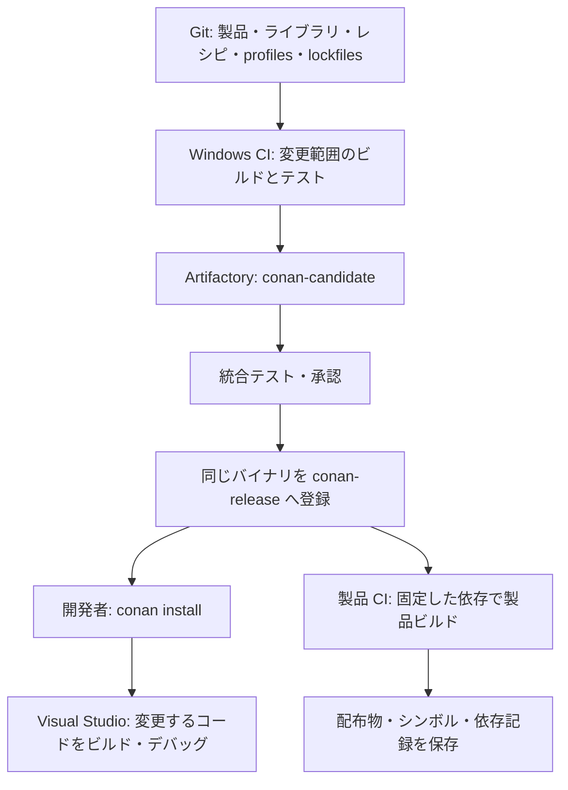

# Visual Studio・Conan・Artifactory 運用提案

作成日: 2026-10-17

## 1. 提案の前提と結論

対象は約1,000万行の C++ 製品。Visual Studio IDE＋MSVC、既存の `.sln/.vcxproj` を使っていると仮定します。
実際の Visual Studio・MSVC の世代、CMake の有無、開発人数、CI 製品、現在のビルド時間は未確認です。
本書は運用設計の提案であり、製品ソースや Windows 上での動作検証は行っていません。

**既存ビルドを維持し、外部依存と安定した社内ライブラリを Conan 2 でバイナリ配布する構成を推奨します。**
最初から全面 CMake 化、マイクロリポジトリ化、全プロジェクトのパッケージ化は行いません。
Git の構成と Conan パッケージの境界は独立して決めます。モノレポのまま導入できます。

- Visual Studio / MSBuild: 編集、デバッグ、自分が変更するコードのビルド。
- Conan 2: 依存グラフの解決、構成別バイナリの取得、ビルド設定の生成。
- Windows CI: 共通バイナリのビルド・検証・登録、製品の統合テスト。
- 本 Artifactory: CI で検証したパッケージの共有・保管。

Conan は `.obj` 単位のコンパイルキャッシュや分散コンパイラではありません。
効果は「変更しない依存ライブラリを開発者ごとにコンパイルしない」ことです。
フルリンクや巨大な共通ヘッダーによる再コンパイルは別途改善します。

## 2. 全体フロー



平常時の開発者は `conan-release` だけを参照します。
候補パッケージを使う検証は、専用の CI ジョブまたは分離した Conan キャッシュで実施します。

## 3. パッケージを切る単位

| 対象 | 最初の扱い | 理由 |
| --- | --- | --- |
| 外部 OSS・商用 SDK | ライセンス上可能なものから Conan 化 | 重複ビルドと端末ごとの設定差を減らせる |
| 変更の少ない社内共通ライブラリ | 所有チーム・公開 API 単位で Conan 化 | 他チームの変更から独立して配布できる |
| 日常的に同時変更する製品内部コード | 既存のプロジェクト参照でソースビルド | パッケージ更新の待ち時間を増やさない |
| 相互依存・循環参照するライブラリ群 | 当初は同じビルド単位にまとめる | 循環依存を Conan に持ち込まない |
| コード生成ツール | 実行環境用の `tool_requires` として管理 | 生成対象ライブラリとの構成を区別する |

「1 vcxproj = 1 package」とはしません。公開ヘッダー、ABI、責任者、独立リリースの必要性で判断します。
ライブラリを変更するときは既存のソースビルド経路を利用し、CI でパッケージ消費経路も検証します。
ローカルのソース差し替えが頻繁になった部分だけ、Conan editable の採用を後から検討します。

## 4. Artifactory は Local リポジトリ2つから開始

| リポジトリ | 内容 | 書き込み権限 |
| --- | --- | --- |
| `conan-candidate` | CI で作った承認前パッケージ | パッケージ作成 CI |
| `conan-release` | 検証・承認済みの社内ライブラリと外部依存 | リリース CI のみ |

両方とも Package Type は Conan。まずは CE の Local リポジトリと権限設定で完結させます。
Virtual、外部プロキシ、自動昇格の専用機能、HA を必須にしません。
CE の対応機能は実際のバージョンで確認し、上位エディションの機能を前提に設計しないでください。
[CE の基本的な Conan 連携](https://docs.conan.io/2/tutorial/conan_repositories/setting_up_conan_remotes/artifactory/artifactory_ce_cpp.html)

- 開発者: release の読み取り。admin アカウントを共有しない。
- CI: 用途別アカウント・トークン。削除権限は原則付与しない。
- 外部依存: 担当者がソース・ライセンス・脆弱性情報を確認し、必要構成を社内 CI で用意して release に登録。
- ConanCenter の直接利用は調査・取り込み担当の環境に限定。日常開発と製品 CI は社内 release を使う。
- 同じ名前・バージョンに別内容を配布しない。変更時はバージョンを上げる。

候補と正式版はリポジトリで区別し、Conan の channel を承認状態として使いません。
承認時はテストした recipe revision・package ID・package revision を記録し、**その同じ成果物**を release に登録します。
新しいバージョン名に置き換えて再ビルドしたものは別の検証対象です。

最小の昇格方法は、検証済みキャッシュから対象 revision を限定して release へ `conan upload` することです。
CI 間でキャッシュを引き継がない場合は、記録した完全参照で candidate から取得して登録します。
ワイルドカードですべてのキャッシュ内容を送らず、依存パッケージも release に揃っていることを確認します。
[Conan upload](https://docs.conan.io/2/reference/commands/upload.html)

## 5. MSVC の構成を先に揃える

当初の標準構成は **Windows x64 × Debug / Release の2種類**とします。
既存製品が必要とする x86、ARM64、独自構成は追加しますが、使わない構成を先回りして増やしません。

| 項目 | 運用ルール |
| --- | --- |
| Visual Studio / Build Tools | 製品で検証したバージョンを明記。IDE とコンパイラの版を区別する |
| MSVC・Windows SDK | CI のインストール構成を記録・固定し、更新は専用 PR で検証 |
| CRT | 既存方針を優先。新規統一案は Release `/MD`、Debug `/MDd`。`/MT` と混在させない |
| C++ 標準 | 既存設定を維持し、導入と同時に言語規格を変更しない |
| ABI | `_ITERATOR_DEBUG_LEVEL`、構造体 packing、例外・RTTI、公開マクロを確認 |
| DLL 境界 | メモリ確保・解放の責任と STL 型を渡す箇所を確認する |
| LTCG | `/GL`・`/LTCG` を使うライブラリはコンパイラ更新時の再ビルド対象として扱う |

MSVC のバイナリ互換性には条件があります。「Visual Studio の世代が近いので全部混ぜられる」と判断しません。
[Microsoft の互換性条件](https://learn.microsoft.com/en-us/cpp/porting/binary-compat-2015-2017?view=msvc-170)

以下は **Visual Studio 2022 / MSVC 19.4x / C++17 を選んだ場合の profile 例**です。
採用中のツールセット・規格に置き換えてください。VS の更新を提案する例ではありません。

`profiles/windows-release`:

```ini
[settings]
os=Windows
arch=x86_64
compiler=msvc
compiler.version=194
compiler.cppstd=17
compiler.runtime=dynamic
compiler.runtime_type=Release
build_type=Release
```

`profiles/windows-debug`:

```ini
include(./windows-release)

[settings]
compiler.runtime_type=Debug
build_type=Debug
```

profile、Conan の採用バージョン、CI の Build Tools / SDK 構成を Git で管理します。
`compiler.version=194` だけでは MSVC の正確なパッチ版まで固定できません。
独自 ABI オプションを切り替える必要がある場合は、recipe の settings/options と package ID に反映します。
`conan profile detect` は初期調査用に留め、開発・CI はレビュー済み profile を使用します。
[profiles](https://docs.conan.io/2/reference/config_files/profiles.html)、[Conan の運用指針](https://docs.conan.io/2/knowledge/guidelines.html)

## 6. Visual Studio への組み込みと日常開発

既存 MSBuild プロジェクトには Conan 2 の `MSBuildDeps` と `MSBuildToolchain` を使用します。
製品または管理するビルド単位に consumer 用 `conanfile.py` を置き、settings と依存を宣言します。

- `MSBuildDeps`: include、lib、依存関係を `.props` として生成。
- `MSBuildToolchain`: CRT・C++ 標準などの構成を `.props` として生成。
- 生成物は `build/conan/` など Git 管理外へ出力。生成した `.props` を手で編集しない。
- 各 vcxproj の適切な PropertySheets 位置から、必要な生成 `.props` を読み込む。
- 大きな solution 全体へ `conandeps.props` を一律 import せず、各プロジェクトが使う `conan_<package>.props` / component を選ぶ。
- ツールチェーン設定と既存 PropertySheets の上書きを確認し、依存不足を個別の絶対パス追加で回避しない。

同じ生成先へ Debug / Release を順番に install すると構成別 props が生成され、IDE の切り替えに利用できます。
プロジェクト単位で外部依存とパッケージ化した社内依存を宣言し、Conan の依存グラフと一致させます。
[MSBuildDeps](https://docs.conan.io/2/reference/tools/microsoft/msbuilddeps.html)、[MSBuildToolchain](https://docs.conan.io/2/reference/tools/microsoft/msbuildtoolchain.html)

初回設定例（PowerShell）。以下の URL とユーザー名は運用環境のものに置き換えます。
Windows 端末から Linux サーバーへ接続する場合、`localhost` はその Windows 端末自身なので使用しません。

```powershell
conan remote add release https://packages.example.internal/artifactory/api/conan/conan-release
conan remote login release developer-user
conan remote disable conancenter
```

`conancenter` が登録されている場合に無効化します。トークン・パスワードは Git に保存せず、CI はシークレット管理を使用します。
Conan キャッシュに残った未承認パッケージを避けるため、実験用と通常業務用の `CONAN_HOME` を分けます。
[remote コマンド](https://docs.conan.io/2/reference/commands/remote.html)

日常の取得・ビルド例。`conanfile.py` は上記2つの generator を有効にし、独自 layout は未設定という例です。
`locks/` の lockfile は次節の更新担当が生成して Git に登録しておきます。

```powershell
conan install . -pr:h=profiles/windows-release -pr:b=profiles/windows-release --lockfile=locks/windows-release.lock --build=never -r=release -of=build/conan
conan install . -pr:h=profiles/windows-debug -pr:b=profiles/windows-release --lockfile=locks/windows-debug.lock --build=never -r=release -of=build/conan
msbuild Product.sln /m /p:Configuration=Debug /p:Platform=x64
```

`Product.sln` は実際の solution 名へ置き換えます。MSBuild を利用できる Developer PowerShell 等で実行します。
Conan コマンド失敗時はその時点で処理を止め、古い生成物でビルドを続行しない運用にします。
依存が欠けていたら CI 側で追加し、各端末で自動コンパイルしてしのがない方針です。
[conan install](https://docs.conan.io/2/reference/commands/install.html)

## 7. 依存更新・バイナリ作成・リリース

### 依存更新 PR

1. ライブラリ担当が `conanfile.py` の依存バージョンを変更する。
2. 必要な構成のバイナリを CI が作成し、単体テストと小さな消費側 `test_package` を実行する。
3. candidate に登録し、影響する製品・ライブラリで統合テストする。
4. 承認した同じ revision の成果物を release に登録する。
5. 更新担当が製品の lockfile を release を使って作り直し、依存グラフの差分と一緒にレビューする。
6. 製品 CI が lockfile と `--build=never` でビルド・テストしてマージする。

lockfile 作成例（出力先 `locks/` を事前に作成）:

```powershell
conan lock create . -pr:h=profiles/windows-release -pr:b=profiles/windows-release --lockfile-out=locks/windows-release.lock -r=release
conan lock create . -pr:h=profiles/windows-debug -pr:b=profiles/windows-release --lockfile-out=locks/windows-debug.lock -r=release
```

依存更新の意図に応じて既存 lockfile の扱いと `--update` を明示し、通常ビルドで暗黙に最新版へ更新しません。
lockfile は依存レシピのバージョン・revision を固定しますが、ツールチェーンや全バイナリ revision を単独で固定するものではありません。
リリースには、profiles、ツールの版、解決結果 JSON、完全なパッケージ参照も保存します。
[Lockfiles](https://docs.conan.io/2/tutorial/versioning/lockfiles.html)

### CI の実行範囲

| タイミング | 実行内容 |
| --- | --- |
| PR | 変更パッケージ＋依存する側の影響範囲。単体テスト、代表的な統合テスト |
| main | 影響範囲の Debug / Release、主要製品の統合テスト |
| 夜間 | 全体ビルド・広範囲テスト。差分判定の漏れを検出 |
| リリース | 新規キャッシュで依存取得できることを検証し、正式構成で製品・インストーラーを作成 |

逆依存を含む DAG をもとに対象を決めます。変更ファイルのパスだけで再ビルド範囲を決めません。
共通ヘッダー、recipe、profile、コード生成、コンパイラの変更は影響範囲を広げます。
最初に依存関係が把握できない領域は保守的に再ビルドし、記録が揃ってから絞ります。

CI はジョブごとに `CONAN_HOME` を分離し、複数ジョブで同じ書き込みキャッシュを共有しません。
同一ジョブ内の compiler 並列実行とは区別します。Conan キャッシュをネットワーク共有フォルダに置かないでください。
[キャッシュの並行利用に関する公式指針](https://docs.conan.io/2/knowledge/guidelines.html)

同じ recipe revision・package ID を複数 CI が同時に公開しないよう担当ジョブを1つにします。
再生成した package revision を無条件に正式版へ追加せず、変更理由を確認します。
製品リリースには Git commit、lockfiles、profiles、RREV / package ID / PREV、テスト結果、配布物ハッシュ、PDB を紐付けます。
DLL を必要とする依存は、インストーラーへの同梱とクリーンな端末での起動も検証します。
障害時は変更前の commit・lockfiles・保持済み依存へ戻して製品を再ビルドします。

## 8. 1,000万行規模で優先して測ること

行数だけでは CI 台数・ストレージ・メモリ量を決められません。導入前後で同じ端末・構成を比較します。

| 指標 | 確認したいこと |
| --- | --- |
| 初回セットアップからビルド成功まで | 新メンバーが環境構築できるか |
| 依存 install 時間・ダウンロード量 | パッケージ粒度、ネットワーク、PDB 配布量が適切か |
| 無変更ビルド・1 cpp 変更・公開ヘッダー変更 | 増分ビルドとヘッダー依存の問題を区別 |
| コンパイル時間とリンク時間 | Conan 化で減らせる時間と別施策が必要な時間を区別 |
| CI 待ち時間・パッケージ再利用率 | runner 増設とパッケージ境界見直しの判断 |
| Artifactory の応答、容量増加、復旧時間 | サーバー増強・保存期間の判断 |

最初の受け入れ条件は、対象依存を `--build=never` で取得でき、Debug/Release が両方動き、
開発者と CI の構成差がなく、新規 CI キャッシュでも正式版を再現できることです。
「何分以内」「何％短縮」は現状を測定してから決めます。
全体のフルビルド高速化を Conan だけの成果として約束しません。

## 9. 本 Artifactory をチーム運用する際の変更点

現状の Compose はローカル検証向けです。パッケージ管理の導入実験には使えますが、
1,000万行規模の製品を支える共有サーバーにする前に以下を整えます。

- 社内 DNS 名＋HTTPS を用意。開発端末と Windows CI が同じ URL を使えるようにする。[自己署名証明書による HTTPS 化の手順](https-patterns.md)を参照。
- 管理者、開発者、CI の権限を分離。匿名アクセスと admin の共用を避ける。
- `.volumes/artifactory` と PostgreSQL を整合性の取れる方法でバックアップし、別ホストで復元テストする。
- リリースに使った依存・レシピ・シンボルは製品の保守期間中保持。candidate の削除期間はチームで決定する。
- リリース参照中の revision は容量整理で削除しない。ローカルキャッシュを唯一の保管先にしない。
- 4 GiB 制限は現在の検証設定。実際の同時利用数と公式要件に基づきメモリ・CPU・SSD・空き容量を見直す。
- `latest` イメージの取得は計画した保守時のみ。取得した実イメージの識別情報を更新記録に残す。
- 単一ホスト停止時の許容停止時間・復旧手順・担当者を決める。HA や他エディションは必要性が出てから検討する。

Artifactory を停止しても、必要なパッケージが手元に揃う開発者は作業を続けられる構成を目指します。
一方で新規 CI・新規端末は影響を受けるため、復元時間の検証が必要です。
[JFrog のサーバー要件](https://docs.jfrog.com/installation/docs/general-system-requirements)

## 10. 導入順序

1. **現状調査**: solution 構成、外部 DLL/lib、CRT、MSVC/SDK、循環依存、時間計測を整理する。
2. **小規模実証**: 製品1つ・外部ライブラリ数個を対象に、2構成・2リポジトリ・CI 公開を通す。
3. **標準化**: profiles、Conan 採用版、生成 props の取り込み、lockfile 更新、権限、バックアップを文書化する。
4. **段階展開**: ビルド負荷が高く変更の少ない社内ライブラリからチーム単位で導入する。
5. **運用改善**: 測定結果をもとにパッケージ境界、CI 並列度、ヘッダー依存・リンク時間を改善する。

最初に決めるのは「代表製品」「使う MSVC/SDK と CRT」「最初に配布するライブラリ」「担当 CI」です。
既存ビルドの大改造と依存管理の導入を同じプロジェクトにせず、小さな対象で効果と復旧手順を確かめてから広げます。
