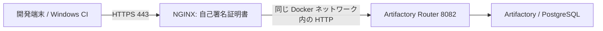

# Artifactory の HTTPS 化（自己署名証明書）

更新日: 2026-10-17

## 1. 採用する構成

**OpenSSL で自己署名のサーバー証明書を作り、NGINX で HTTPS を受ける構成**にします。
公開 CA・社内 CA への申請や ACME の仕組みを追加せず、Artifactory・PostgreSQL は現構成を維持します。
証明書の作成、配布、期限管理は自分たちで行います。

本書は導入手順です。利用する DNS 名は未確定のため例示名を使っています。
リポジトリの Compose は HTTPS 構成に対応済みです。実環境への適用は証明書作成後に行います。



端末が証明書を明示的に信頼することで、暗号化に加えて接続先も検証します。
この設定では、バックエンドの HTTP 通信や PostgreSQL 通信まで暗号化されるわけではありません。

## 2. 接続する名前を決める

例として `packages.example.internal` を使います。採用する名前を `.env` の `HTTPS_HOSTNAME` と証明書の SAN に設定し、Conan も同じ名前で接続してください。
社内 DNS または検証用 hosts に、その名前と Artifactory ホストの IP の対応を登録します。
Windows の `localhost` は Windows 端末自身です。共有サーバー用の名前を使用します。

証明書には URL と一致する名前を **SAN（Subject Alternative Name）**として含めます。
CN の指定だけでは足りません。IP アドレスで接続するなら DNS の代わりに `IP:実際のIP` を SAN に指定します。
DNS 名と IP を両方使う場合は `DNS:名前,IP:実際のIP` とします。

## 3. 自己署名証明書を作成する

Artifactory を動かす Linux ホストで、リポジトリのルートから [setup.sh](../setup.sh) を実行します（OpenSSL 3 を使用）。
`.env` の作成（未作成時）、`.volumes/artifactory`・`.volumes/postgres` の作成と権限設定、および `.env` の `HTTPS_HOSTNAME`（未設定時は `localhost`）または第1引数の名前を使った自己署名証明書の作成をまとめて行います。既存の `.env` や証明書・鍵がある場合は上書きしません。

```bash
# .env の HTTPS_HOSTNAME を使用する場合
bash setup.sh

# ホスト名を引数で直接指定する場合
bash setup.sh packages.example.internal
```

`.volumes/nginx/certs/` に以下のファイルが作成されます。

- `server.key`: 秘密鍵。サーバーだけに保管し、クライアントへ配布しません。
- `server.crt`: PEM 形式の証明書。NGINX と Conan の信頼設定に使用します。
- `server.cer`: 同じ証明書の DER 形式。Windows への登録に使用します。

ここではサーバー証明書自体を自己署名しています。別の CA や中間証明書は作りません。
`CA:FALSE` のため、他の証明書を発行する用途には使いません。
無人起動する NGINX 用に秘密鍵のパスフレーズを付けず、ファイル権限とホストへのアクセスで保護します。
`.volumes/` は Git の管理対象外です。
[OpenSSL req の公式仕様](https://docs.openssl.org/3.0/man1/openssl-req/)

## 4. NGINX と Compose の設定

NGINX は [docker-compose.yml](../docker-compose.yml) に定義済みです。
[設定テンプレート](../nginx/default.conf.template) に `.env` の `HTTPS_HOSTNAME` と `HTTPS_PORT`（初期値 `443`）が起動時に反映されます。
80番は公開せず、最初から HTTPS（`HTTPS_PORT`）で接続します。Artifactory の8081/8082も直接公開しません。

- 証明書: `.volumes/nginx/certs/server.crt`
- 秘密鍵: `.volumes/nginx/certs/server.key`
- 公開 URL: `https://HTTPS_HOSTNAMEの値/ui/`
- 転送先: 同じ Docker ネットワークの `http://artifactory:8082`

[README の起動手順](../README.md)に従って証明書を作成し、起動してください。
既存環境にも `docker compose up -d` で反映します。証明書と接続名が準備できるまで適用しません。
[JFrog のリバースプロキシ設定](https://docs.jfrog.com/installation/docs/http-settings)

4 GiB のサイズ上限と600秒のタイムアウトは例です。大きな PDB を含むパッケージで調整します。
[NGINX のプロキシ設定](https://nginx.org/en/docs/http/ngx_http_proxy_module.html)

設定検査は、Artifactory が同じ Docker ネットワークで稼働している状態で実行します。

```bash
docker compose run --rm --no-deps nginx nginx -t
```

NGINX は起動時に `artifactory` を名前解決する構成なので、Artifactory 再作成で IP が変わった場合は
`docker compose restart nginx` で再解決します。
テンプレートや `HTTPS_HOSTNAME` を変更した場合も NGINX の再起動・再作成が必要です。

## 5. Windows と Conan で証明書を信頼する

### Windows / ブラウザ

信頼できる経路で `server.cer` を配布し、サーバーで表示した SHA-256 フィンガープリントと一致することを確認します。
自分たちで作った証明書であると確認してから、信頼する証明書として登録します。

個人の開発端末で現在のユーザーへ登録する例（PowerShell）:

```powershell
certutil -user -addstore Root C:\company\certs\server.cer
```

チーム配布には GPO 等を使用できます。Windows CI はサービス実行アカウントが異なるため、
管理者が LocalMachine の信頼ストア等、実行環境に適した範囲へ登録して確認します。
ブラウザごとの独自証明書ストア・企業ポリシーも確認してください。

### Conan / Python

Windows の登録だけでは Conan が使う Python/Requests に反映されない環境があります。
`server.crt` を PEM のまま端末・CI へ配布し、Conan の `global.conf` に設定します。
`conan config home` で設定ディレクトリを確認できます。

```ini
core.net.http:cacert_path=C:/company/certs/server.crt
```

この証明書だけを指定すると、ほかの公開 CA を必要とする HTTPS 接続の検証に影響する場合があります。
その場合は必要な公開 CA とこの証明書をまとめた PEM バンドルを用意し、そのファイルを指定します。
秘密鍵はバンドルに含めません。
`verify_ssl=False`、`--insecure`、`curl -k` による検証回避は使用しません。
[Conan の証明書設定](https://docs.conan.io/2/reference/config_files/global_conf.html)

remote を HTTPS に更新します（PowerShell）。実際のリポジトリ名に合わせてください。

```powershell
conan remote update release --url=https://packages.example.internal/artifactory/api/conan/conan-release
conan remote login release developer-user
```

candidate を利用する CI も同じ接続名と信頼設定を使います。

## 6. 動作確認と更新

サーバーや検証端末で、証明書検証を有効にした接続を確認します。

```bash
curl --cacert .volumes/nginx/certs/server.crt --fail \
  https://packages.example.internal/router/api/v1/system/health
```

- 開発端末・Windows CI から同じ DNS 名で UI ログインと Conan の取得・アップロードが成功する。
- 新規 Conan キャッシュでも取得でき、大容量パッケージをアップロードできる。
- 公開ポートは443番だけで、80/8091/8092へ直接接続できない。
- 再起動後も接続でき、HTTP や内部名へリダイレクトされない。

有効期限は10年（3650日）です。担当者を決めて期限前に更新し、ファイルを取り替えて NGINX を再読込します。
`setup.sh` は既存ファイルの上書きを防ぐため、更新時は既存の証明書を退避・削除してから再実行してください。

**自己署名のサーバー証明書を更新すると、Windows・Conan 側にも新証明書の配布が必要です。**
新証明書を先に信頼させてからサーバーを切り替え、確認後に旧証明書の信頼を解除します。
Conan のバンドルには切り替え期間中、新旧両方を含めます。

```bash
docker compose exec -T nginx nginx -t
docker compose exec -T nginx nginx -s reload
```

端末数が多くなり、毎回の証明書配布が負担になったら「自己署名のルート CA＋そこから発行するサーバー証明書」へ移行します。
その場合、CA が有効で信頼も維持されていれば、サーバー証明書の更新ごとに全端末へ配布する必要がなくなります。
